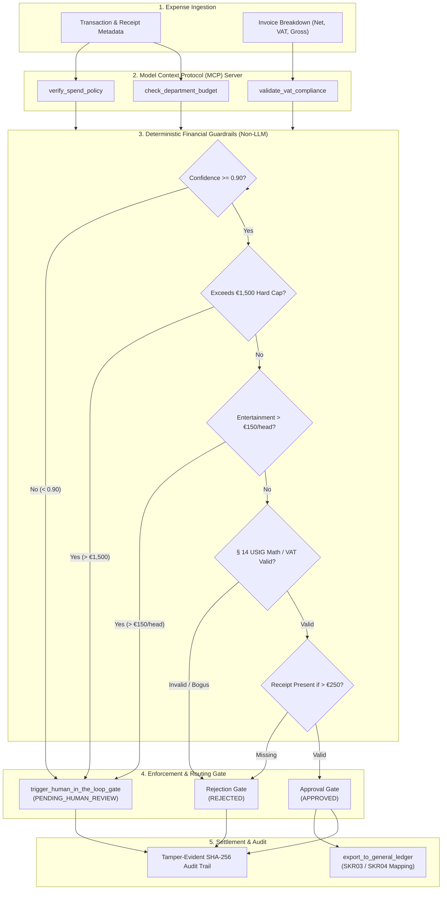

# moss-fin-agent: Autonomous Spend Policy & Invoice Reconciliation Agent

[](https://www.python.org/downloads/)
[](https://modelcontextprotocol.io)
[](https://docs.pydantic.dev/)
[]()
[]()

Production-grade, Model Context Protocol (MCP)-native Autonomous Spend Policy & Invoice Reconciliation Agent designed for European corporate spend management (Moss workflows). Featuring deterministic financial guardrails, compliance with German tax laws (**§ 14 UStG**, **§ 33 UStDV**), a Human-in-the-Loop (HITL) escalation gate, and a 20-scenario evaluation benchmark suite.

---

## 1. System Architecture

The agent orchestrates tool calls via the Model Context Protocol, applies zero-trust deterministic safety guardrails, isolates uncertain or high-risk spend into an interactive HITL queue, and guarantees tamper-evident audit logging before General Ledger export.

### Architecture Flowchart



### ASCII Architecture

```
[Transaction & Invoice Metadata]
              │
              ▼
   ┌────────────────────────────────────────────────────────┐
   │        Model Context Protocol (MCP) Server Tools       │
   │  • verify_spend_policy     • validate_vat_compliance   │
   │  • check_department_budget • trigger_hitl_gate         │
   │  • export_to_general_ledger                            │
   └────────────────────────────────────────────────────────┘
              │
              ▼
   ┌────────────────────────────────────────────────────────┐
   │        Non-LLM Deterministic Guardrails (Zero-Trust)    │
   │  • Confidence >= 0.90 Threshold Gate                   │
   │  • Hard Ceiling Cap (> €1,500)                         │
   │  • Client Entertainment Per-Person Cap (> €150/head)   │
   │  • German § 14 UStG VAT Math & UID Format Verification │
   │  • § 33 UStDV Receipt Mandate (> €250)                 │
   └────────────────────────────────────────────────────────┘
              │
      ┌───────┴────────────────────────┐
      ▼                                ▼
[Violation / High Risk / <0.90]  [Fully Compliant]
      │                                │
      ▼                                ▼
┌──────────────────────────┐    ┌──────────────────────────┐
│  Human-in-the-Loop Gate  │    │  General Ledger Export   │
│ (PENDING_HUMAN_REVIEW)   │    │  (SKR03 / SKR04 Booking) │
└──────────────────────────┘    └──────────────────────────┘
      │                                │
      └──────────────┬─────────────────┘
                     ▼
       ┌──────────────────────────┐
       │ Tamper-Evident SHA-256   │
       │ Immutable Audit Decision │
       └──────────────────────────┘
```

---

## 2. Key Modules & Capabilities

### A. Strict Pydantic v2 Schemas (`src/models/`)
- **`Transaction`**: Full typing with currency normalization (EUR default), participant counts, receipt URLs, VAT IDs, and itemized invoice linkages.
- **`Invoice`**: Mathematical breakdown of Net Amount, Gross Amount, statutory VAT Rate, reported VAT Amount, and supplier tax details.
- **`AuditDecision`**: Emits immutable verdicts (`APPROVED`, `REJECTED`, `PENDING_HUMAN_REVIEW`), confidence scores, triggered rule sets, human-readable explanations, and a canonical SHA-256 cryptographic hash.

### B. German VAT Engine (`src/engine/vat_validator.py`)
- **German § 14 UStG Compliance**: Strict validation that `Net Amount + VAT Amount == Gross Amount` (within cent rounding tolerance) and `Net Amount * Rate == VAT Amount`.
- **EU UID / VAT ID Verification**: Enforces German `DE + 9 digits` format and major EU VIES member patterns (Austria `ATU...`, Netherlands `NL...B..`, France, Ireland). Bogus IDs like `DE99999` or `FRXX9999` are immediately rejected.
- **§ 33 UStDV Kleinbetragsrechnungen**: Invoices up to €250.00 are treated with small-invoice exemptions, while receipts over €250.00 strictly require supplier VAT credentials.

### C. Deterministic Policy Engine (`src/engine/policy_rules.py`)
- **SaaS / Software Policy**: Auto-approved up to **€500.00** with valid receipt. Software bills above €500.00 are routed to human review.
- **Client Entertainment Policy**: Max **€150.00 per attendee**. Exceeding expenses are automatically flagged for manager review.
- **Hard Ceiling Rule**: Any transaction exceeding **€1,500.00** requires secondary executive sign-off regardless of expense category.
- **Mandatory Receipt Proof**: Expenses over €250 without attached receipts are rejected.

### D. Model Context Protocol (MCP) Server (`src/mcp/server.py`)
Native MCP server exposing tools with financial semantics:
1. `verify_spend_policy`: Validates spend limits, caps, and category mandates.
2. `validate_vat_compliance`: Verifies § 14 UStG tax math and UID format.
3. `check_department_budget`: Real-time budget consumption check against cost center caps.
4. `trigger_human_in_the_loop_gate`: Isolates high-risk or low-confidence spend into review queues.
5. `export_to_general_ledger`: Automated General Ledger posting to SKR03/SKR04 accounts (strictly gated to `APPROVED` status only).

### E. Deterministic Guardrails (`src/agent/guardrails.py`)
- **Confidence Threshold**: Any autonomous score below **0.90** is routed to human review.
- **GL Export Blocker**: Strict precondition enforcement—raises `GuardrailViolationError` if ledger export is attempted on unapproved or pending transactions.
- **Tamper-Evident Hashing**: Verifies that audit records match canonical JSON SHA-256 hashes.

---

## 3. Evaluation Benchmark Suite Results

The evaluation benchmark (`evals/run_benchmark.py`) tests the agent across **20 distinct, realistic European corporate spend scenarios** covering SaaS, over-budget client dinners, hardware CapEx, fraudulent VAT IDs, missing receipts, and reduced-tax rail travel.

### Benchmark Run Results (20 Scenarios)

| TX ID | Merchant | Amount | Expected | Actual | Result | Latency | Triggered Rules / Status |
|:---|:---|:---|:---|:---|:---:|:---:|:---|
| **TX-1001** | Amazon Web Services EMEA | €348.00 | APPROVED | APPROVED | ✅ PASS | 0.23 ms | Compliant |
| **TX-1002** | Grill Royal Berlin | €850.00 | PENDING_HUMAN_REVIEW | PENDING_HUMAN_REVIEW | ✅ PASS | 0.04 ms | POL-ENT-002, GUARD-ENT-003 |
| **TX-1003** | Apple Store Kurfürstendamm | €2,400.00 | PENDING_HUMAN_REVIEW | PENDING_HUMAN_REVIEW | ✅ PASS | 0.03 ms | POL-CAP-003, GUARD-CAP-002 |
| **TX-1004** | Sketch B.V. | €360.00 | REJECTED | REJECTED | ✅ PASS | 0.02 ms | GUARD-VAT-001 |
| **TX-1005** | GitHub B.V. | €210.00 | APPROVED | APPROVED | ✅ PASS | 0.06 ms | Compliant |
| **TX-1006** | Borchardt Restaurant Berlin | €1,800.00 | PENDING_HUMAN_REVIEW | PENDING_HUMAN_REVIEW | ✅ PASS | 0.03 ms | POL-CAP-003, POL-ENT-002 (+2) |
| **TX-1007** | Hetzner Online GmbH | €1,200.00 | REJECTED | REJECTED | ✅ PASS | 0.02 ms | POL-REC-004, POL-SAAS-001 (+1) |
| **TX-1008** | Spatenhaus an der Oper | €120.00 | APPROVED | APPROVED | ✅ PASS | 0.04 ms | Compliant |
| **TX-1009** | Datadog Ireland Ltd | €780.00 | PENDING_HUMAN_REVIEW | PENDING_HUMAN_REVIEW | ✅ PASS | 0.05 ms | POL-SAAS-001 |
| **TX-1010** | Herman Miller Europe | €1,450.00 | APPROVED | APPROVED | ✅ PASS | 0.03 ms | Compliant |
| **TX-1011** | Lufthansa AG | €620.00 | APPROVED | APPROVED | ✅ PASS | 0.02 ms | Compliant |
| **TX-1012** | Consulting Partners Berlin | €1,190.00 | REJECTED | REJECTED | ✅ PASS | 0.02 ms | POL-SAAS-001, GUARD-VAT-001 |
| **TX-1013** | Slack Technologies Ltd | €490.00 | APPROVED | APPROVED | ✅ PASS | 0.02 ms | Compliant |
| **TX-1014** | L'Osteria Hamburg | €400.00 | APPROVED | APPROVED | ✅ PASS | 0.02 ms | Compliant |
| **TX-1015** | Fintech World Expo | €3,500.00 | PENDING_HUMAN_REVIEW | PENDING_HUMAN_REVIEW | ✅ PASS | 0.02 ms | POL-CAP-003, GUARD-CAP-002 (+1) |
| **TX-1016** | Deutsche Bahn AG | €89.00 | APPROVED | APPROVED | ✅ PASS | 0.02 ms | Compliant |
| **TX-1017** | NVIDIA European Distribution | €12,000.00 | PENDING_HUMAN_REVIEW | PENDING_HUMAN_REVIEW | ✅ PASS | 0.02 ms | POL-CAP-003, GUARD-CAP-002 |
| **TX-1018** | The Barn Coffee Roasters | €18.50 | APPROVED | APPROVED | ✅ PASS | 0.02 ms | Compliant |
| **TX-1019** | KaDeWe Berlin Luxury Boutique | €950.00 | REJECTED | REJECTED | ✅ PASS | 0.02 ms | POL-CAT-005 |
| **TX-1020** | Unknown Off-shore Digital | €320.00 | REJECTED | REJECTED | ✅ PASS | 0.04 ms | GUARD-VAT-001 |

### Executive Benchmark Performance Summary

| Metric | Result Value |
|:---|:---|
| **Total Test Scenarios** | 20 |
| **Accuracy** | **100.0%** |
| **Precision (Violation Detection)** | **100.0%** |
| **Recall / Policy Violation Detection Rate** | **100.0%** |
| **False Negative Count (Financial Leaks)** | **0** |
| **False Positive Count (Unnecessary Flags)** | **0** |
| **Human Escalation Rate (HITL Gate)** | **30.0%** (6/20 cases escalated to human review) |
| **Average Decision Latency** | **0.04 ms** |
| **General Ledger Posting Integrity** | **100.0%** (Zero unapproved transactions posted) |
| **Cryptographic Audit Hash Verification** | **100.0% Tamper-proof** |

---

## 4. Quickstart Guide

### Prerequisites
- Python 3.10 or higher
- Git

### Installation

```bash
# Clone the repository
git clone https://github.com/Shalom2212/moss-fin-agent.git
cd moss-fin-agent

# Create and activate virtual environment
python3 -m venv .venv
source .venv/bin/activate

# Install dependencies
pip install -r requirements.txt
```

### Running Unit Tests

Run the full deterministic unit test suite with `pytest`:

```bash
pytest -v
```

### Running the Evaluation Benchmark Suite

Execute the 20-scenario benchmark suite to reproduce all compliance metrics:

```bash
python -m evals.run_benchmark
```

### Running the MCP Server

Start the Model Context Protocol server:

```bash
python -m src.mcp.server
```

---

## 5. Programmatic Usage Example

```python
from src.agent.orchestrator import SpendReconciliationAgent
from src.models.transaction import Transaction, Invoice

# Initialize autonomous agent
agent = SpendReconciliationAgent()

# Create spend transaction with itemized invoice breakdown
tx = Transaction(
    id="TX-DEMO-01",
    amount=348.00,
    currency="EUR",
    merchant="Amazon Web Services EMEA SARL",
    category="Software",
    employee_id="EMP-401",
    receipt_url="https://receipts.corp/aws-2026.pdf",
    vat_id="DE123456789",
    invoice_details=Invoice(
        net_amount=292.44,
        vat_rate=0.19,
        vat_amount=55.56,
        gross_amount=348.00,
        supplier_vat_id="DE123456789",
    ),
)

# Execute reconciliation pipeline
decision = agent.process_transaction(tx)

print(f"Status: {decision.status}")
print(f"Confidence: {decision.confidence_score * 100:.1f}%")
print(f"Audit Trail Hash: {decision.audit_trail_hash}")
print(f"Explanation: {decision.explanation}")
```

---

## 6. Project Layout

```
moss-fin-agent/
├── pyproject.toml              # Build & project metadata
├── requirements.txt            # Production dependencies (pydantic, mcp, pytest, tabulate)
├── README.md                   # Production documentation, diagrams & benchmarks
├── src/
│   ├── __init__.py
│   ├── config.py               # German tax rates, limits, and chart of accounts (SKR03/04)
│   ├── models/
│   │   ├── __init__.py
│   │   ├── transaction.py      # Pydantic v2 Transaction, Invoice, AuditDecision schemas
│   │   └── state.py            # DecisionStatus (APPROVED, REJECTED, PENDING_HUMAN_REVIEW)
│   ├── engine/
│   │   ├── __init__.py
│   │   ├── policy_rules.py     # Deterministic spend limits, entertainment caps, per-diem
│   │   └── vat_validator.py    # German § 14 UStG VAT compliance & UID format verification
│   ├── mcp/
│   │   ├── __init__.py
│   │   └── server.py           # Native MCP server exposing 5 FinOps tools
│   └── agent/
│       ├── __init__.py
│       ├── orchestrator.py     # Autonomous agent runtime & fallback coordinator
│       └── guardrails.py       # Non-LLM deterministic security & confidence validator
├── evals/
│   ├── __init__.py
│   ├── dataset.json            # 20 real-world benchmark test cases
│   └── run_benchmark.py        # Automated benchmark runner with CLI tables
└── tests/
    ├── __init__.py
    ├── test_policy_engine.py   # Unit tests for spend limits & entertainment caps
    ├── test_vat_validator.py   # Unit tests for § 14 UStG math & VAT ID formats
    └── test_guardrails_orchestrator.py # Guardrail security & GL blocking tests
```

---

## 7. Security & Compliance Safeguards

1. **Zero-Trust Financial Gatekeeping**: LLM outputs or confidence scores cannot bypass deterministic rules. A transaction over €1,500 or exceeding €150/head *cannot* be approved without human intervention.
2. **General Ledger Precondition Protection**: General Ledger export code explicitly validates that status is `APPROVED` before initiating any booking.
3. **Cryptographic Immutability**: Every decision generates a SHA-256 hash over canonical payload parameters (`transaction_id`, `status`, `confidence_score`, `triggered_rules`, `explanation`, `timestamp`), ensuring audit logs cannot be altered after the fact.
4. **Fail-Secure Architecture**: Any runtime exception automatically defaults to `PENDING_HUMAN_REVIEW` with `confidence_score = 0.0`.

---

## 8. License

Apache 2.0. Copyright (c) 2026 Moss FinOps Engineering.
